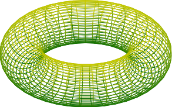
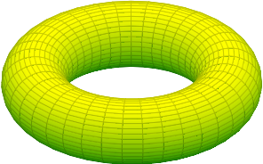

# PDFKitの保存経路と描画情報の保持（2026-10-25追調査）

## 結論と改修範囲

**ページ構成を変えないクロップは、原稿のワークフローを維持した小さな修正で改善できた。**
単一ページのpgfplotsメッシュについて、面・ベクトル情報・余白・原稿の埋め込みと再取得を確認した。
背景合成、複数ページからの抽出、複数PDFの結合は別経路であり、一般的な解決は保留する。

調査はmacOS 27.0.1、Ghostscript 10.07.1、同梱MuPDF 1.28.5で実施した。
従来の「PDFDocument.write全般で必ず壊れる」という説明は範囲が広すぎた。
読み込んだ文書を編集して保存する場合と、新しい文書へページを移して保存する場合とで結果が異なる。

同じメッシュをQuartzで描画した比較（修正前の経路は新規文書へのページ挿入、修正後は元文書のページ構成を維持）:

修正前:

修正後:

## 保存経路の切り分け

新しい `tests/pdfkit_roundtrip_probe.swift` で公開APIを使って比較した。
1ページの参照PDFにあるShadingType 4は1,521個。表の数は調査用の構造確認値。
実装の回帰テストではPDFの参照グラフをたどり、到達可能なシェーディングの数を検査している。

| 操作 | ShadingType 4 | PatternType 1 | 結果 |
|---|---:|---:|---|
| 読み込んだPDFDocumentをそのままwrite | 1,521 | 0 | 保持 |
| 同じ文書のdataRepresentation | 1,521 | 0 | 保持 |
| 同じ文書のMediaBox/CropBox変更→write | 1,521 | 0 | 保持 |
| 同じ文書に非表示Text注釈を追加→write | 1,521 | 0 | 原稿と面を保持 |
| 新規PDFDocumentへページをinsert→write | 0 | 1,521 | 面の見え方と描画情報が変化 |
| CGContext.drawPDFPageでPDFへ描き直す | 0 | 1,521 | 同様に変化 |
| 複数ページの文書からremovePageして1ページを残す | 0 | 1,521 | 同様に変化 |
| PDFPage.dataRepresentationで1ページを取り出す | 0 | 1,521 | 同様に変化 |

Ghostscriptが出力したExtGStateを含むPDFでも、同じ文書の保存・クロップ・注釈追加ではMuPDFの再描画が終了0、新規文書へのinsertでは未定義`/N`の警告になった。
公開APIの呼び方により、既存オブジェクトを保持する保存と再描画を伴う保存が切り替わると考えられる。
Apple内部の実装までは確認していない。OSの違いによる挙動差の可能性もある。

Appleの[PDFDocumentWriteOption](https://developer.apple.com/documentation/pdfkit/pdfdocumentwriteoption)には、メッシュや元のコンテンツストリームの保持を保証するオプションは公開されていない。
`burnInAnnotationsOption=false`を加えるだけでページ移動・再描画の問題全体を解決できる根拠はない。

## 3種類の問題を分ける

### 1. xrefのoffset 0警告

前回qpdfが警告した28ファイルを調べた。使用中を表す`n`で登録されているのに、ファイル位置が0のxrefスロットが残っていた。
例えば7ページ目の単独出力ではオブジェクト5・7・12。
全28ファイルで、これらはtrailerからたどる参照グラフに含まれなかった。
今回のfixtureでは、未使用スロットの管理情報の不整合であり、参照される描画資源が欠けた例ではなかった。

qpdfや[MuPDF clean](https://mupdf.readthedocs.io/en/latest/tools/mutool-clean.html)で書き直せる種類の問題。
ただし、xrefの整理で後述の描画情報の変化まで復元できるわけではない。

### 2. ExtGState参照が未定義の`/N`になる

元のGhostscript出力ではコンテンツが`/R7 gs`と`/R12 gs`を使い、対応する辞書も存在する。
例の内容は次のとおり。

- R7: `SA=false`
- R12: `TR=Identity`、BG（黒生成）とUCR（下色除去）の関数

新規PDFDocumentへのinsert→write後は、辞書側にBG用`Gs1`・UCR用`Gs2`が作られる一方、コンテンツには`/N gs`が2回出る。`N`という資源は登録されていない。
MuPDFの`cannot find ExtGState resource 'N'`は、この不一致を検出している。

`N`を一律にNormalとして補う、または名前を機械的に置換する方法では、元の複数の状態と順序を一般的に復元できない。
色処理に影響し得るため、汎用の自動修復としては採用しない。

### 3. メッシュが画像パターンに変わり、境界座標も異常になる

元の1,521個のShadingType 4は、再保存後には小さな画像を描く1,521個のPatternType 1へ変換されていた。
各パターンのBBoxに約±8.99×10^307という座標が出力される。
Quartzへ再入力してビットマップ描画すると面が消え、ワイヤーフレームになる。MuPDFでは面も見えるが、低解像度の画像化による段差が見える。
したがって、特定のビューアで表示できることだけをもって正常とは扱えない。

調査用コピーでBBoxを有限の範囲へ置換するとQuartzでも面が戻ったが、画像化による段差は残った。
これは原因の切り分けには役立つが、元のベクトルメッシュへ戻す修復にはならない。
この置換処理は製品コードに入れていない。

## 実施した修正

### ページ構成を保つクロップ

`Converter-BoundingBox.swift` の `generateCroppedPDF` で、対象ページ数が入力の全ページ数と一致する場合は、読み込んだ文書のページ境界を変更してその文書を保存する。
従来は必ず新しいPDFDocumentを作ってページをinsertしていた。

- 単一ページ入力のクロップ、および全ページを一度にクロップする中間処理が対象。
- 境界計算、回転、余白指定、出力形式の選択、ユーザーの操作手順は維持。
- 複数ページのうち1ページを取り出す場合は、既存の抽出経路を維持している。
- 背景色の合成と複数PDFの結合は、今回の修正の対象外。

結果として、既存の単一ページ・透過・`--with-text`のpgfplots再現ケースは、1,521個のメッシュを保持するようになった。
アウトライン化を指定した場合も、このfixtureのメッシュは保持される。

### 原稿の拡張属性保存

原稿の復元検査で、`filePath.withCString { $0 }` の戻り値を後で使う既存コードを発見した。
ポインタの有効期間を越えており、実際に拡張属性が保存されていなかった。
`setxattr`をネストした`withCString`の内側で呼ぶよう修正した。

日本語を含むTeX原稿をpdfTeXでコンパイルし、メッシュを含むPDFを生成して検査した。

- 非表示・印刷対象外のText注釈に、従来の`%%TeX2img Document`ヘッダと原稿を保存。
- `com.loveinequality.TeX2img`の拡張属性にも同じ原稿を保存。
- 拡張属性を持たないコピーでも、PDFKitで注釈から原稿をバイト単位で復元。
- 原稿を埋め込んだ後も到達可能なメッシュ数は1,521個。

## 残りを保留する理由と将来案

| 処理 | 検討結果 |
|---|---|
| 複数ページからの抽出 | 同梱MuPDFのcleanによるページ選択ではメッシュと原稿注釈を保持できた。PDFKitのremovePageやPDFPage.dataRepresentationでは保持できなかった |
| PDF結合 | 同梱MuPDFのmergeならメッシュを保持できたが、既存のText注釈は引き継がれなかった。元PDFの注釈や原稿情報の扱いを設計する必要がある |
| 背景色の合成 | 元の描画内容を変更せず、矩形のコンテンツストリームを前置する方式が候補。現在のCore Graphicsによる描き直しを置き換える必要がある |
| xref警告のみの整理 | 後処理で整理可能だが、描画情報の問題全体を解消したかのようには扱えない |
| 原稿埋め込み | ページ構成を変えない保存では保持できた。原稿注釈を廃止する必要はない |

以前の「必ずqpdfを新たに同梱しなければ修正できない」という結論も強すぎた。
今回同梱したMuPDFの実体はmutoolであり、clean/merge等の機能も含まれる。
調査用コピーをmutoolという名前で起動して確認した。製品のmudraw呼び出し規約や配布物には変更していない。

ただし、汎用の背景合成、注釈を保持する結合、ページ参照・回転・フォーム・色管理を含めた互換性まで維持するには、PDF編集部分のまとまった改修と検査が必要。
単純なツール置換だけでは原稿・注釈の情報を落とすため、これらの一般対応は**既存の問題として保留**する。
透明出力、単一ページの原稿という通常の使い方は、今回の小さな修正で改善する。

## 再現・検証

- `tests/pdfkit_roundtrip_probe.swift`: PDFKitの各保存経路を比較する調査用コード。
- `tests/test_pdfkit_page_preservation.py`: 単一ページ、余白、アウトライン、原稿埋め込み、非ゼロ原点と4方向回転を両CPUで検査。
- 回転ケースは元コンテンツを維持した参照PDFとの描画ハッシュも照合。
- ローカルのログ・生成物は `build/pdfkit-investigation/` と、その `root.txt` に記録した一時ディレクトリに保存。

最終Releaseアプリで、既存80ケース×両CPUの計160件、別枠メッシュ2件、メッシュ保持・原稿・回転の追加16件がすべて合格した。
原稿の復元は拡張属性と、拡張属性を除去したPDFのPDFKit注釈読み取りの両方でバイト単位の一致を確認した。
ReleaseのGUI/CLIビルド、署名のdeep/strict検査、9 Mach-OのUniversal Binary・最低OS検査も合格。
新しいAPIやライブラリは追加しておらず、最低OSは12.0のまま。

実行検証は本機とRosettaで行った。macOS 12実機で同じPDFKitの保存挙動になるかは未検証。
GUIでの読み戻しも、Macのロック解除後に同じ最終Releaseアプリで追加確認した。
「ファイル」→「インポート」から、原稿の拡張属性付きPDFと、拡張属性を除去したPDFをそれぞれ読み込み、日本語コメントを含む原稿全文が直接入力欄へ復元されることを確認した（2件とも合格）。
PDFのインポートは拡張属性の有無によらずPDF注釈を読む実装であり、今回のGUI確認はその経路を検証するもの。拡張属性そのものの一致検証は前述のデータ検査で行っている。
確認後は本文を空にし、出力先をテスト前の`/Users/taylor/Desktop/equation.eps`へ戻した。画像生成は実行しておらず、既存の出力ファイルは上書きしていない。
